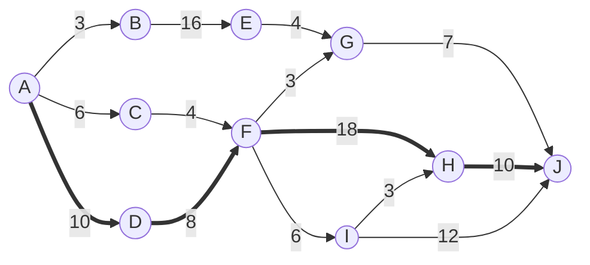

# AOE 网、关键路径与活动松弛时间

> 模块：05 数据结构（兼 08 软件工程项目管理） ｜ 状态：🟦（错题建档，待正式 5 题自适应验收与真题校准） ｜ 创建：2026-11-26

## 定义
- **AOE 网（Activity On Edge）**：带权有向无环图，**顶点表示事件（里程碑）**，**有向边表示活动**，边权表示活动持续时间。
- **关键路径**：从源点到汇点路径长度**最长**的路径（可能不止一条）。
- **松弛时间（总时差）**：在不推迟整个工程完成时间的前提下，某活动可以推迟开始的最大时间；关键路径上所有活动的松弛时间均为 **0**。

## 要点与考场秒杀公式

### 核心结论
1. **完成整个工程的最少时间 = 关键路径（最长路径）的长度**。
   - 因为工程各分支并行执行，必须等耗时最长的路径走完，整个项目才算完工。
2. **某活动的松弛时间（考场最快公式）**：
   $$\text{松弛时间}(u \to v) = \text{关键路径总长度} - \text{经过边 } (u \to v) \text{ 的最长路径长度}$$
3. **标准事件时间定义法**：
   - 正向递推事件最早发生时间 $ve(j) = \max_{(i,j) \in E}\{ve(i) + w(i,j)\}$；
   - 逆向递推事件最晚发生时间 $vl(i) = \min_{(i,j) \in E}\{vl(j) - w(i,j)\}$；
   - 活动最早开始 $ES(i,j) = ve(i)$，最晚开始 $LS(i,j) = vl(j) - w(i,j)$；
   - 松弛时间 $= LS(i,j) - ES(i,j) = vl(j) - ve(i) - w(i,j)$。

### 完整案例（关联 `#错006`、`#错007`）

1. **求最少工期**：
   - $ve(A)=0, ve(B)=3, ve(C)=6, ve(D)=10, ve(E)=19$
   - $ve(F)=\max(6+4, 10+8)=18$
   - $ve(G)=\max(19+4, 18+3)=23$
   - $ve(I)=18+6=24$
   - $ve(H)=\max(18+18, 24+3)=36$
   - $ve(J)=\max(23+7, 36+10, 24+12)=46$
   - 关键路径为 `A → D → F → H → J`，最少工期 = **46 天**。
2. **求活动 `FG` 的松弛时间**：
   - 到 `F` 的最长路径：`A → D → F` = $10 + 8 = 18$；
   - 活动 `FG` 耗时：$3$；
   - 从 `G` 到终点 `J` 的最长路径：`G → J` = $7$；
   - 经过 `FG` 的最长路径 $= 18 + 3 + 7 = 28$；
   - 松弛时间 $= 46 - 28 = \mathbf{18}$ 天。

## 易错点
1. **被“最少时间”字面误导去算最短路径**：项目工期是**最长**路径（关键路径），千万别找最短路！
2. **算经过某活动的最长路径时漏掉前半段或后半段的最长分支**：一定要对起点到 `u` 取最长、对 `v` 到终点取最长。

## 真题考法
- 上午高频 2 联空：第 1 空求最少完成时间（关键路径长），第 2 空求某非关键活动的松弛时间，或问加快哪项活动能缩短总工期。

## 我的笔记
- （待补充个人记忆点）
