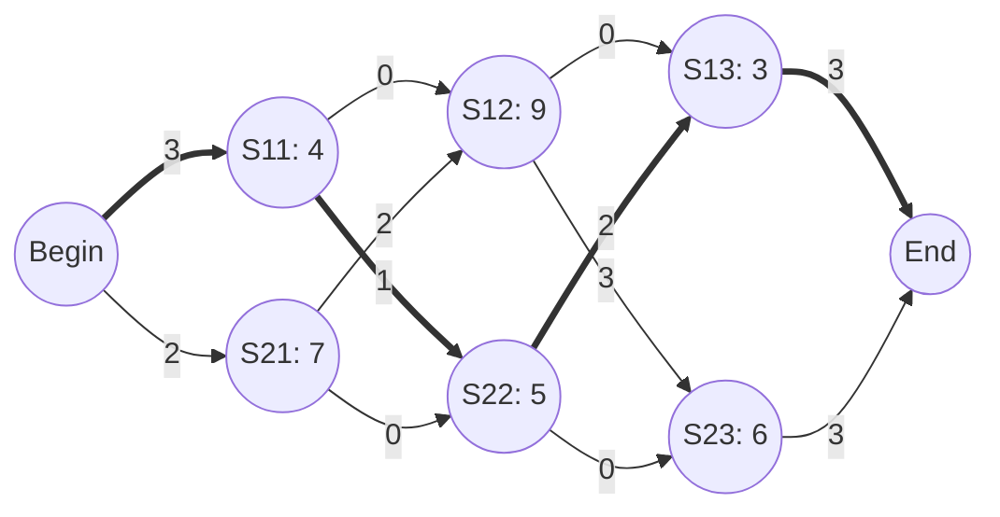

# 动态规划：装配线调度与主定理速记

> 模块：06 算法设计与分析 ｜ 状态：🟦（错题建档，待正式 5 题自适应验收与真题校准） ｜ 创建：2026-11-26

## 一、装配线调度（关联 `#错050`、`#错051`）

### 定义与实例图
两条装配线 $L_1, L_2$ 各有 $n$ 个工位，每站有加工时间 $a_{i,j}$，跨线切换有迁移时间 $t_{i,j}$，另有进线时间 $e_1, e_2$ 与出线时间 $x_1, x_2$，求完成一辆车装配的**最短总时间**。

*(粗箭头 `==>` 标出最短路径 `Begin → S11 → S22 → S13 → End`，总耗时 $3+4+1+5+2+3+3 = \mathbf{21}$)*

### 要点（状态转移与复杂度）
- 第 1 站：$f_1[1] = e_1 + a_{1,1} = 3 + 4 = 7$，$f_2[1] = e_2 + a_{2,1} = 2 + 7 = 9$。
- 第 $j$ 站（$j \ge 2$）：
  - $f_1[j] = \min(f_1[j-1] + 0,\; f_2[j-1] + t_{2,j-1}) + a_{1,j}$
  - $f_2[j] = \min(f_2[j-1] + 0,\; f_1[j-1] + t_{1,j-1}) + a_{2,j}$
- 逐步手算上表：
  - 第 2 站：$f_1[2] = \min(7+0,\; 9+2) + 9 = 16$；$f_2[2] = \min(9+0,\; 7+1) + 5 = \mathbf{13}$
  - 第 3 站：$f_1[3] = \min(16+0,\; 13+2) + 3 = \mathbf{18}$；$f_2[3] = \min(13+0,\; 16+3) + 6 = 19$
  - 最终答案：$\min(18+3,\; 19+3) = \mathbf{21}$。
- **时间复杂度**：只需一重循环从 $j=1$ 推到 $n$，每步常数次比较 → **$\Theta(n)$**（不是 $\Theta(n\log n)$！）。

---

## 二、主定理扩展情况（关联 `#错017`）

对递归式 $T(n) = aT(n/b) + f(n)$，先算 $n^{\log_b a}$ 与 $f(n)$ 比较：
- $T(n) = 2T(n/2) + n$：$n^{\log_2 2} = n$ 与 $f(n) = n$ 同阶 → $\Theta(n\log n)$。
- **$T(n) = 2T(n/2) + n\log n$**：属于扩展主定理 Case 2（$f(n) = \Theta(n^{\log_b a}\log^k n)$，此处 $k=1$）→ **$\Theta(n\log^{k+1} n) = \Theta(n\log^2 n)$**。

## 易错点
1. 算装配线耗时容易**漏加斜边切换代价**（如漏加 `S11 → S22` 的 `1` 算出 20）或漏加出线时间。
2. 别把装配线调度（走一条路求**最短**）和 AOE 活动图（并行全做求**最长**）搞混！
3. 看到 $T(n)=2T(n/2)+n\log n$ 别惯性选 $\Theta(n\log n)$，每层代价 $n\log n$ 乘上树高 $\log n$ 得 $\Theta(n\log^2 n)$。

## 秒题技巧
1. 装配线调度问**算法策略**秒选「动态规划」，问**时间复杂度**秒选 **$\Theta(n)$**；算最短时间按「从左到右逐列标最小累计值」，最后加出口权值取 `min`。
2. 主定理看到 $f(n) = n^{\log_b a}\cdot\log^k n$ 直接把 $\log$ 的幂次 **+1**（$n\log n \to n\log^2 n$）。

## 我的笔记
- （待补充个人记忆点）
