# UML 看图秒题指南（配标准图示：关系 + 图种 + 14 种设计模式类图）

> 模块：09 面向对象与 UML（兼 10 设计模式） ｜ 状态：🟦（带图秒杀专题已建档，待分图逐点验收与真题校准） ｜ 创建：2026-11-26

---

## 一、看「线型 + 箭头」2 秒定类图六大关系

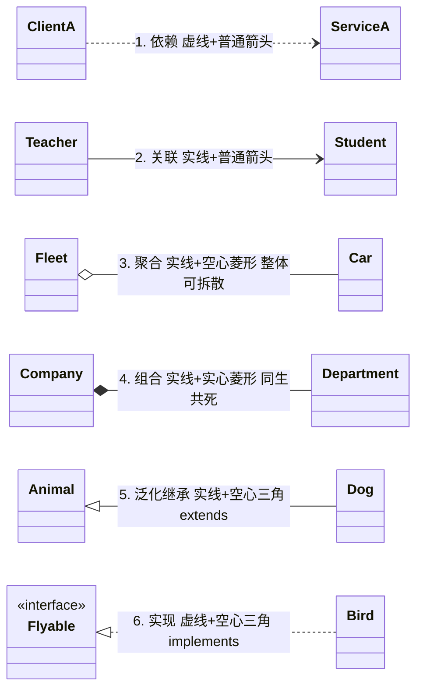

### 3 秒秒杀口诀
1. **虚线只有 2 种**：普通箭头 `..>` = **依赖**；空心三角 `<|..` = **实现（`implements`）**。
2. **空心三角只有 2 种**：实线 `<|--` = **泛化/继承（`extends`）**；虚线 `<|..` = **实现（`implements`）**。
3. **菱形永远贴在「整体」那一端**：**空心聚合可拆散，实心组合同生死**。
4. **强弱排序**：**组合 > 聚合 > 关联 > 依赖**。
5. **成员符号**：`+` public、`-` private、`#` protected、`~` package；**斜体** = 抽象；**下划线** = `static` 静态；看 `A` 对应几个 `B` 时，读**靠近 `B` 那一头**的多重度数字。

---

## 二、看「画面特征」2 秒辨认 UML 高频动态图

### 1. 用例图：`include` vs `extend` 箭头方向（必考！）

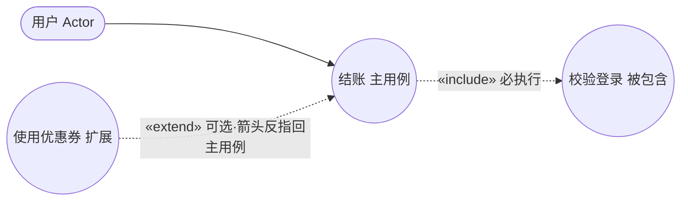

- **秒杀口诀**：`include` 从**主用例指出去**（必做）；`extend` 从**扩展用例指回来**（可选）。

### 2. 序列图（看纵向虚线生命线 + `alt`/`opt`/`loop` 框）

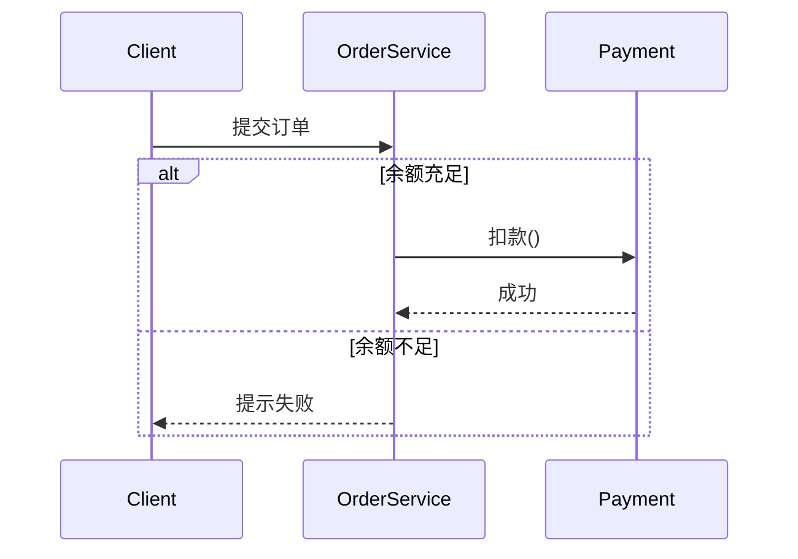

- **秒杀区分**：有**纵向时间虚线** = **序列图**（强调时间顺序）；**没有纵轴时间线**、只在对象连线上标 `1:`、`1.1:`、`2:` 编号 = **通信图**（强调对象结构链接，与序列图等价可互转）。

### 3. 状态图（单个对象的生命周期流转）

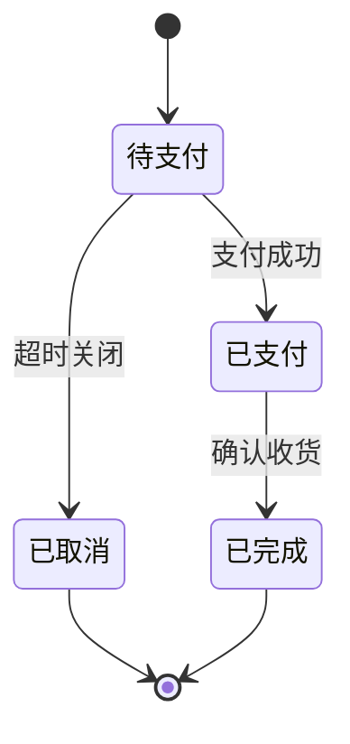

- **秒杀区分**：**黑圆起点 → 圆角矩形状态 → 双圈终点**，边标 `事件[条件]/动作` = **状态图**；出现**菱形判断 + 粗黑并行条（分叉/汇合）+ 泳道** = **活动图**。

### 4. 其余静态图一眼特征
- **对象图**：矩形内对象名带**下划线**（如 `u1: User`），表示某一时刻实例快照。
- **构件图**：矩形右上角带小插头图标 + 棒棒糖接口（`○—` 提供、`⊂—` 需求）。
- **部署图**：**3D 立体长方体（Node 节点）**，表示物理服务器/硬件部署拓扑。

---

## 三、看「UML 类图拓扑」3 秒秒杀 14 种高频设计模式

> 配合 GoF 分类口诀：**「工适解模」是类模式，其余 19 种全是对象模式！**（工厂方法、类适配器、解释器、模板方法）

---

### A. 创建型（5 种）

#### 1. 原型模式（Prototype · 创建型对象）— 盯 `Cloneable` + `+clone()`
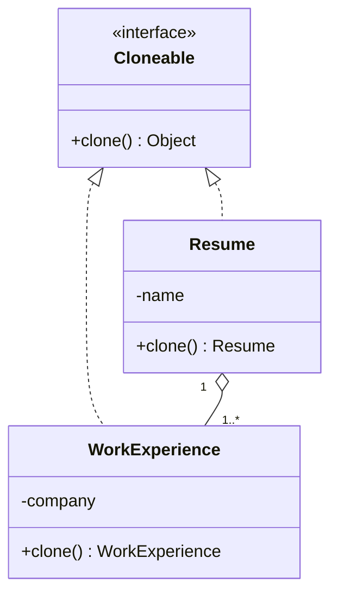
- **一眼秒杀**：顶层出现 `Cloneable` 或 `+clone()` → 直接秒选 **原型**（关联 `#错013`）。

#### 2. 单例模式（Singleton · 创建型对象）— 盯静态自身实例 + 私有构造
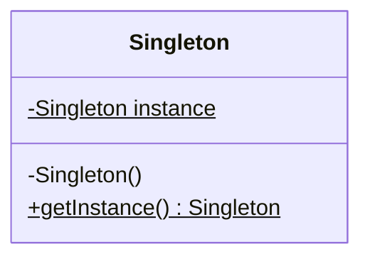
- **一眼秒杀**：类图里往往只有**一个孤零零的类**，带下划线静态 `-instance`、`-Singleton()` 私有构造、`+getInstance()` 静态获取方法。

#### 3. 建造者/生成器模式（Builder · 创建型对象）— 盯 `Director o-- Builder`
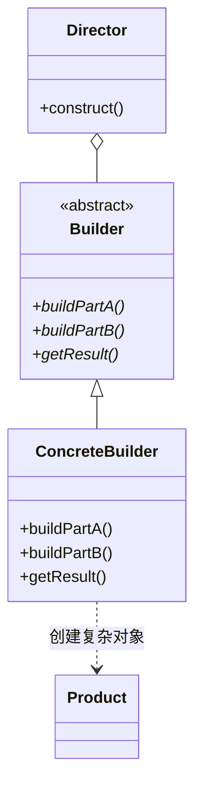
- **一眼秒杀**：有指挥者 `Director` 聚合 `Builder`，方法名带 `buildPartA / buildPartB / getResult`（分步组装复杂对象）。

#### 4. 工厂方法（创建型类） vs 抽象工厂（创建型对象）— 看「单产品」还是「产品族」
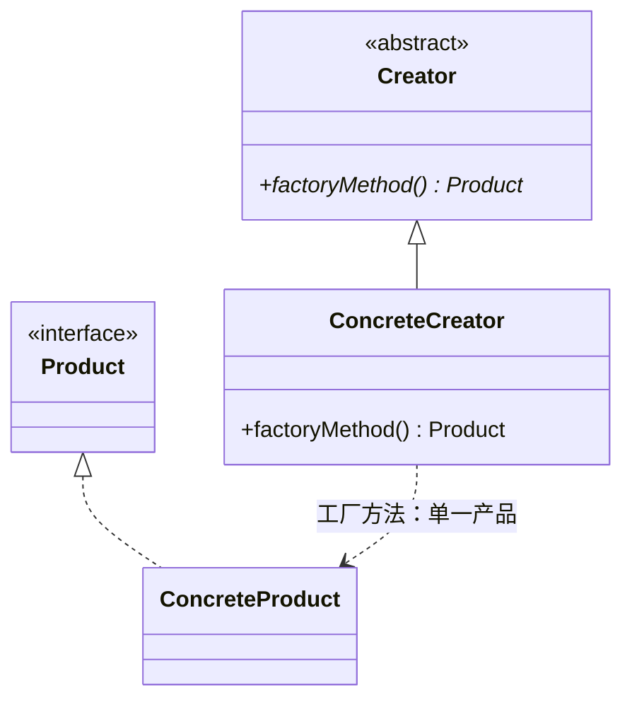

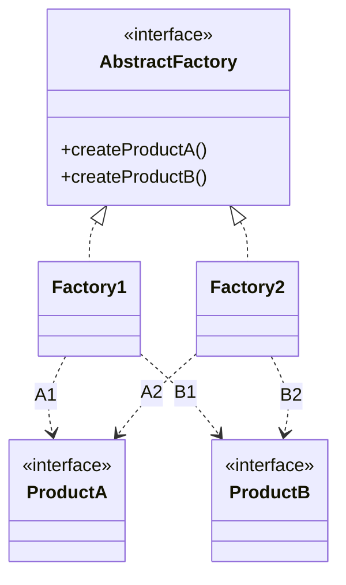
- **一眼秒杀**：只有一个 `factoryMethod()` 造一种产品 = **工厂方法（类模式）**；有多个 `createProductA/B()` 同时造一族配套产品 = **抽象工厂（对象模式）**。

---

### B. 结构型（6 种 · 重点盯撞脸图）

#### 5. 桥接模式（Bridge · 结构型对象）— 「左右两棵继承树，顶层架座桥」
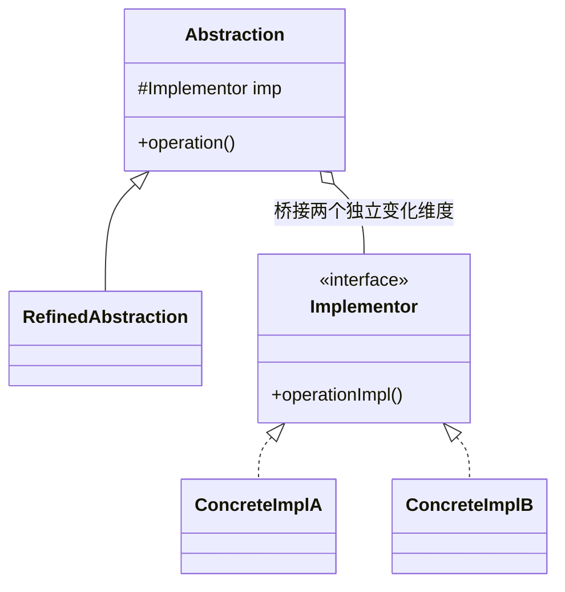
- **一眼秒杀**：左右各有一棵继承树（如左「图形：圆/矩形」，右「颜色：红/蓝」），**两个顶层类之间拉一根空心菱形聚合线** → 100% 是 **桥接**！

#### 6. 组合模式 vs 装饰器模式（最常撞脸！都「既继承父类又持有父类」）

**组合模式（Composite · 结构型对象）— `0..*` 树形容器 + 叶子结点**
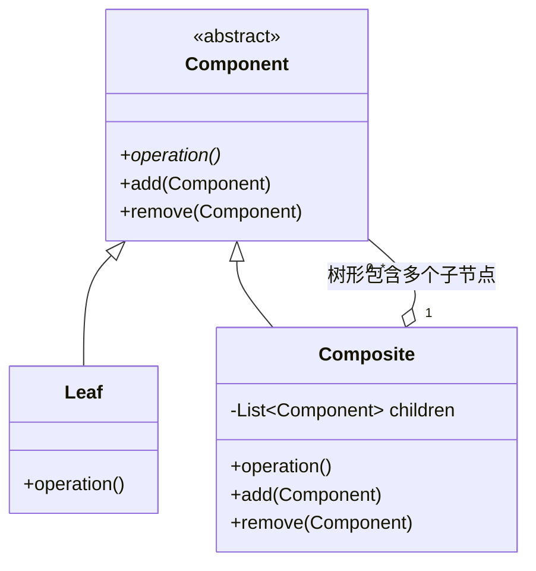

**装饰器模式（Decorator · 结构型对象）— `1` 对 `1` 套娃增强职责**
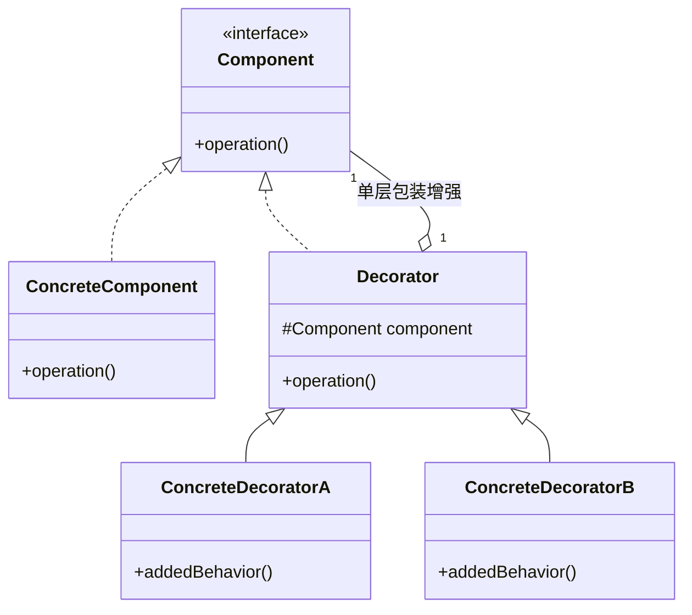
- **1 秒区分**：同样出现「子类往父类画回一根菱形线」，**多重度 `0..*` + `add/remove` + `Leaf/Composite`** = **组合**；**多重度 `1` + `Decorator` 下还有多个具体装饰子类** = **装饰器**。

#### 7. 适配器模式（Adapter · 结构型类/对象）— 转换不兼容旧接口
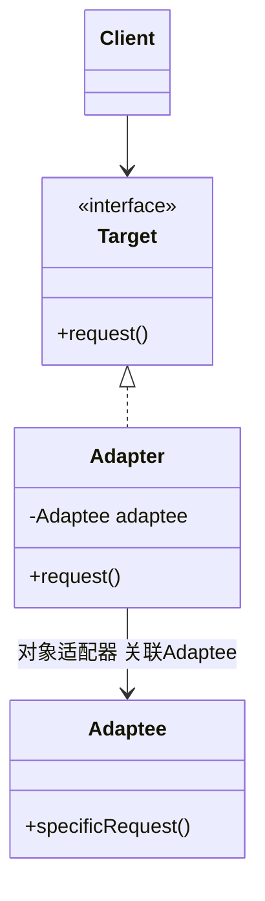
- **一眼秒杀**：`Adapter` 一边实现新接口 `Target`，一边连着旧类 `Adaptee`（若 `Adapter` 对 `Adaptee` 是实线继承 `<|--` 则为**类适配器**，若是关联/组合箭头 `-->` 则为**对象适配器**）。

#### 8. 代理模式（Proxy · 结构型对象）— 与真实对象实现同一接口并持有它
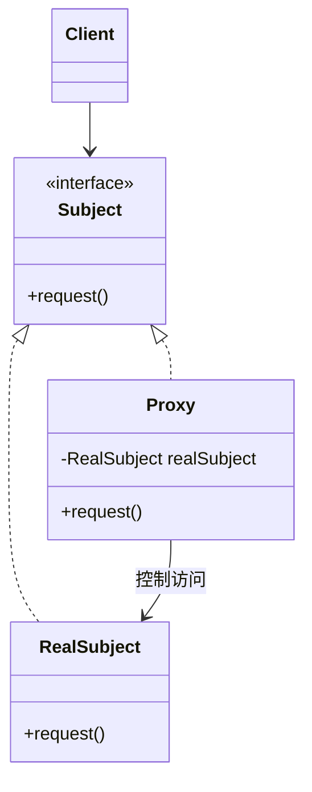
- **一眼秒杀**：`Proxy` 和 `RealSubject` 实现同一个 `Subject` 接口，且 `Proxy` 直接指向平级的 `RealSubject`（注意区别：装饰器指向的是顶层抽象 `Component`，代理通常直接持有具体 `RealSubject`）。

#### 9. 外观模式（Facade · 结构型对象）— 一对多统一入口
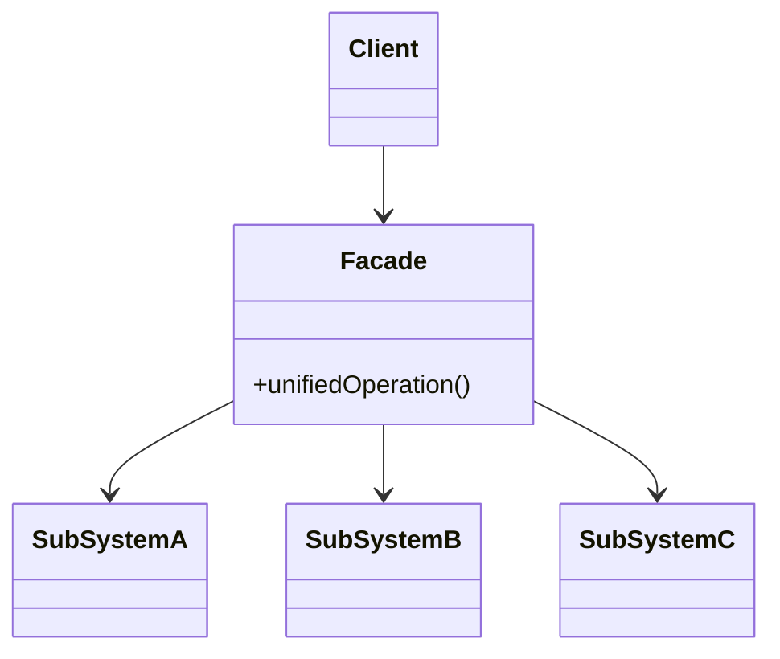
- **一眼秒杀**：上面一个 `Facade` 伞盖住下面一堆 `SubSystemA/B/C`，**单向向下指**（区别于中介者的内部双向协调）。

---

### C. 行为型（5 种 · 重点盯自关联、星型与撞脸图）

#### 10. 责任链模式（Chain of Responsibility · 行为型对象）— 盯「抽象类自关联 `next`」
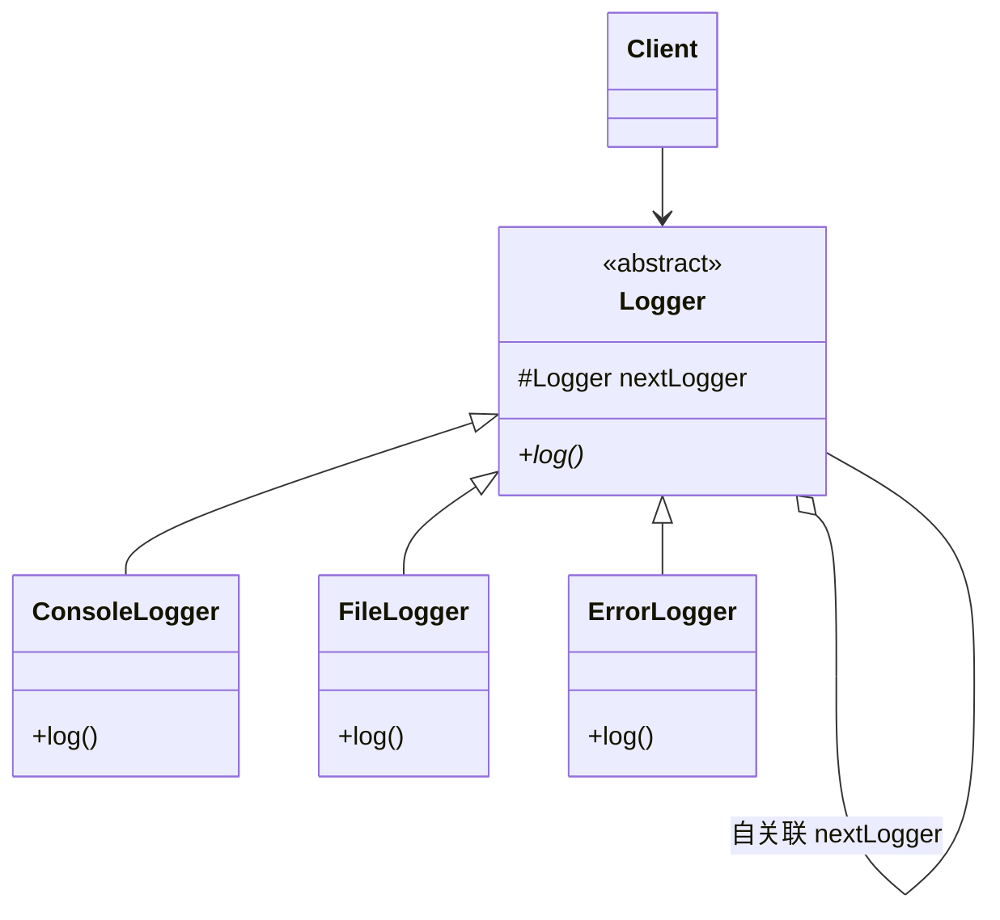
- **一眼秒杀**：抽象处理者**自己画一条线连回自己**（`nextLogger` / `successor`）+ 下面一排平级具体处理子类 → 100% 秒选 **责任链**（关联 `#错010`～`#错012`）。

#### 11. 中介者模式（Mediator · 行为型对象）— 盯「中间协调者双向连两边」
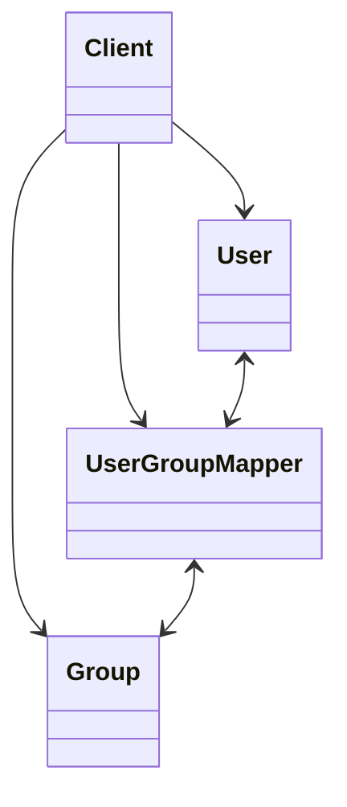
- **一眼秒杀**：`User` 与 `Group` 之间**没有连线**，全都连到中间的 `UserGroupMapper`（或 `Mediator`）双向交互 → 秒选 **中介者**（关联 `#错008`、`#错009`）。

#### 12. 观察者模式（Observer · 行为型对象）— 盯 `attach/detach/notify` + `update`
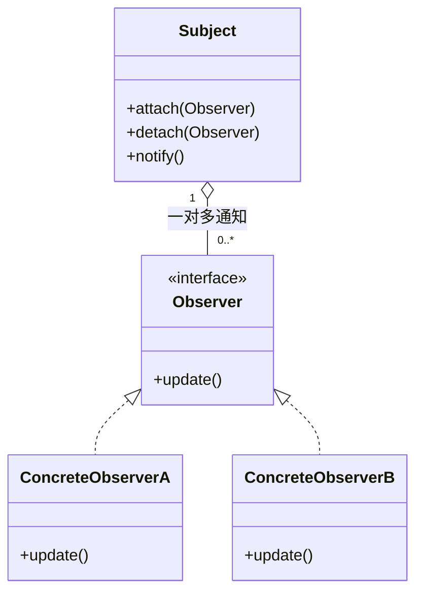
- **一眼秒杀**：左边 `Subject` 有 `attach/detach/notify` 并聚合 `0..*` 个右边 `Observer`（带 `update()`）→ 秒选 **观察者**。

#### 13. 模板方法模式（Template Method · 行为型类）— 盯父类具体骨架调用斜体步骤
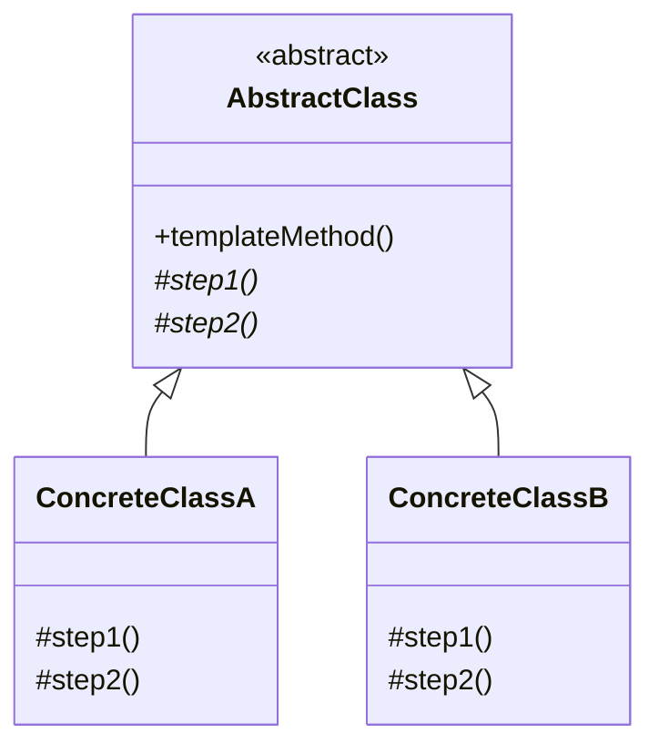
- **一眼秒杀**：只有**纯继承树**（没有任何聚合/关联线），父类一个非抽象骨架方法调用若干斜体抽象原语方法，子类只重写步骤 → 秒选 **模板方法（行为型 · 类模式）**。

#### 14. 策略模式 vs 状态模式（最常撞脸！都长成 `Context o-- Interface`）

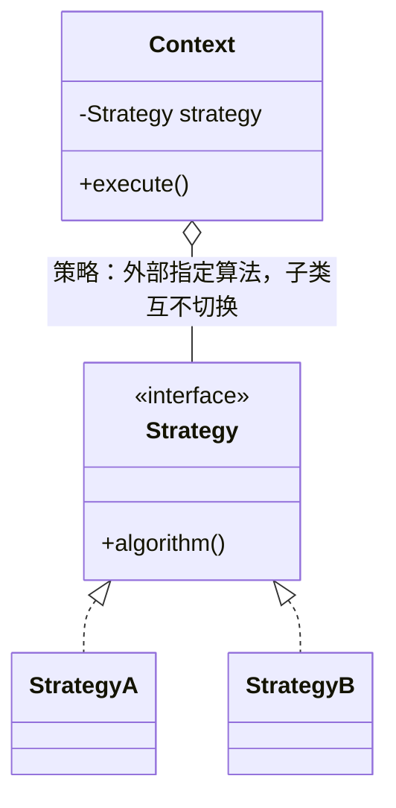

```mermaid
classDiagram
  class OrderContext {
    -State state
    +setState(State)
    +handle()
  }
  class State {
    <<interface>>
    +handle(OrderContext)
  }
  class UnpaidState
  class PaidState
  OrderContext o-- State : 状态：子类内部回调 setState 自动流转
  State <|.. UnpaidState
  State <|.. PaidState
  UnpaidState ..> OrderContext
  PaidState ..> OrderContext
```
- **1 秒区分**：两者类图几乎一模一样，看**谁触发切换**：
  - 题干说「可互换算法 / 消除多重 `if-else` / 客户端选折扣或排序方式」→ **策略**；
  - 题干说「对象状态改变时行为随之改变 / 自动流转到下一状态（如订单待支付→已支付）」或子类方法参数带 `Context` 回调切换状态 → **状态**。

---

## 我的笔记
- （待补充个人看图经验）
