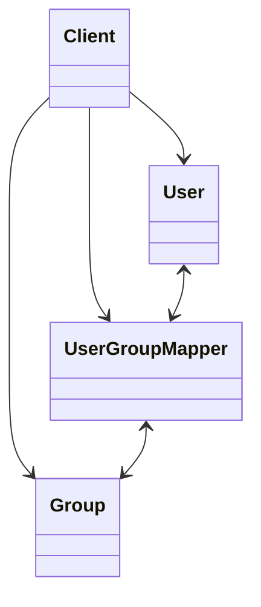

# 中介者模式（Mediator）

> 模块：10 设计模式 ｜ 分类：**行为型 · 对象模式** ｜ 状态：🟦（错题建档，待正式验收与真题校准） ｜ 创建：2026-11-26

## 定义
用一个**中介对象**来封装一系列的对象交互。中介者使各对象不需要显式地相互引用，从而使其耦合松散，而且可以独立地改变它们之间的交互。

## 要点

- **结构转变**：把对象之间复杂的**多对多网状引用**，收敛为通过中介者中转的**星型结构**。
- **类图典型特征**（关联 `#错008`、`#错009`）：
  - `User` 与 `Group` 之间没有直接连线，而是都与中间的 `UserGroupMapper` 双向关联，由 `UserGroupMapper` 统一维护映射与交互。
- **归类**：**行为型 · 对象模式**。
- **适用场景**：
  1. 一组对象以定义良好但复杂的方式通信，相互依赖结构混乱难以理解；
  2. 一个对象引用其他很多对象并直接通信，导致难以复用；
  3. 想定制分布在多个类中的行为，而又不想生成太多子类。

## 易错点
1. **中介者 vs 策略**：策略模式封装的是「可互换的算法/行为」；中介者封装的是「多个对象之间的相互通信/交互」。
2. **分类误判**：中介者虽然有中间协调对象，但它聚焦的是**对象间通信行为的解耦**，属于**行为型 · 对象模式**，不是创建型或结构型。

## 真题考法
- 聊天室、航空管制塔台、用户与权限组映射（`UserGroupMapper`）等场景，题干几乎会原样出现「用一个对象封装一系列对象交互，使各对象不需要显式相互引用」。

## 秒题技巧
1. **题干原话秒选**：只要看到「**用一个对象封装一系列对象交互**」「**不需要显式相互引用**」「**多对多变星型**」→ 直接秒选 **中介者（Mediator）**。
2. **分类 2 秒排除**：先用「工适解模」排除类模式；再看关注点是对象间的「通信协作行为」而非创建或静态组装 → 稳选 **行为型 · 对象模式**。
3. **与外观/策略一秒区分**：外观（Facade）是给外部客户端包一个统一简化入口（单向对外）；中介者是协调内部多个同事对象互发消息（内部星型调度）；策略是切换算法。

## 我的笔记
- （待补充个人记忆点）
